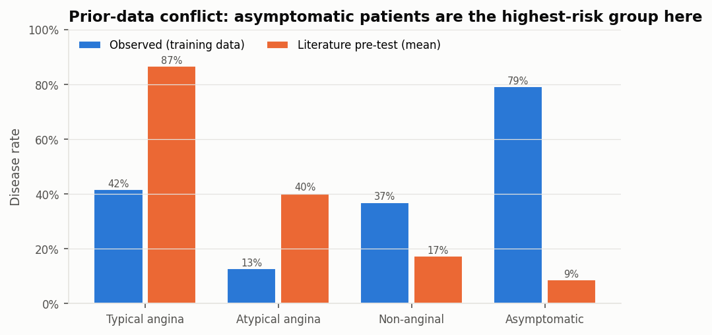
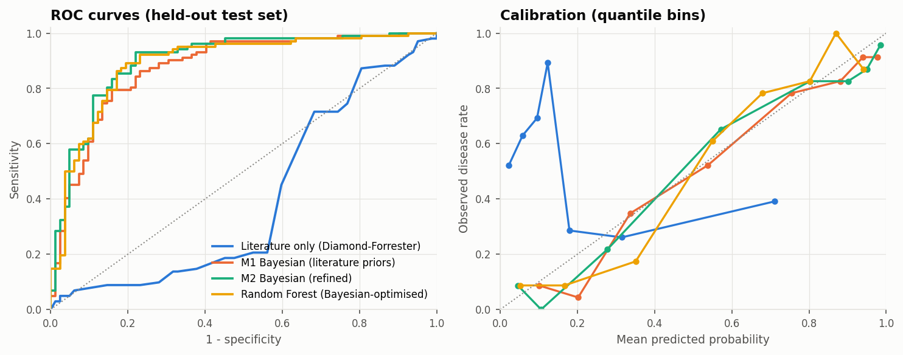
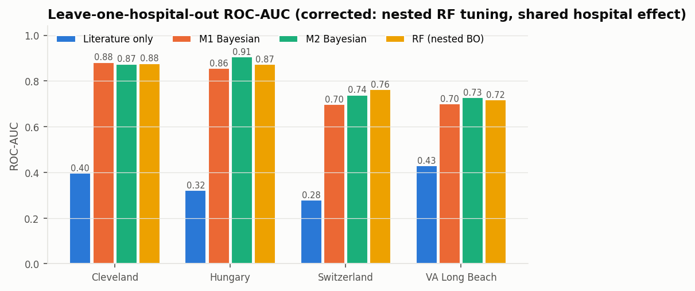
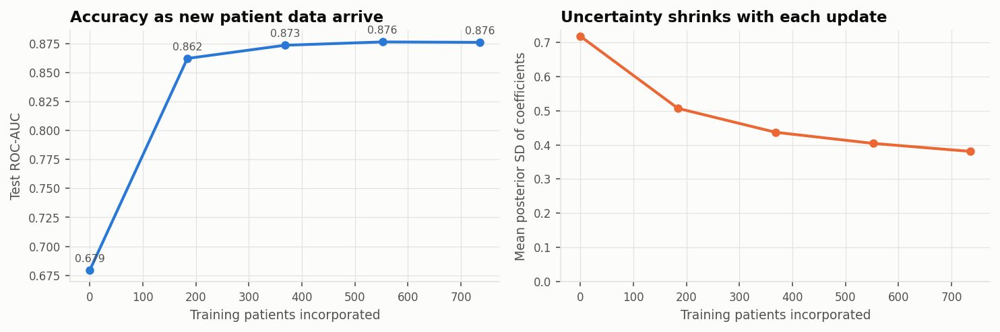

# Medical Diagnosis System: Random Forest and Bayesian Optimization

**Author:** Albert Kabore  
**Academic status:** PhD student in Artificial Intelligence  
**Date:** November 18, 2026

## Introduction

This study evaluates coronary artery disease (CAD) prediction using the UCI Heart Disease datasets. The target is the presence of angiographic disease. The analysis concerns diagnostic classification and does not evaluate future cardiovascular events or multiple disease outcomes.

Random Forest classification with Bayesian hyperparameter optimization is compared with Bayesian logistic regression. The objectives are to assess predictions against recorded diagnoses, evaluate the incorporation of historical probabilities, and examine sequential updating with labelled patient batches. The data originate from a public research archive; no new patient recruitment or hospital data collection was undertaken.

## Step 1. Data collection

The four processed UCI files contain 920 records, including 509 positive diagnoses. Each record has 13 predictors and a diagnosis label. The predictors describe age, sex, chest-pain type, resting blood pressure, cholesterol, fasting glucose, resting ECG, maximum exercise heart rate, exercise-induced angina, ST depression, ST slope, vessels coloured by fluoroscopy, and a thallium result. The binary outcome is `disease = (num > 0)`.

| Hospital dataset | Records | CAD prevalence |
| --- | --- | --- |
| Cleveland | 303 | 45.9% |
| Hungary | 294 | 36.1% |
| Switzerland | 123 | 93.5% |
| VA Long Beach | 200 | 74.5% |
| All | 920 | 55.3% |

The raw files and their documentation match UCI's official archive byte for byte. This confirms their source; it does not independently audit the original hospital measurements. UCI's landing-page total of 303 describes Cleveland, whereas this project pools four processed datasets.

The processed files provide limited clinical history, mainly demographics and test measurements. This implementation addresses one CAD outcome. A system for several diseases would need additional labelled outcomes and suitable priors for each disease.

Question marks are treated as missing. Cholesterol values of zero are set to missing for all 123 Swiss records and 49 VA records; one zero blood-pressure value in the VA data is handled similarly. Continuous and binary imputation statistics are estimated from training data. Missing categorical values are represented by category contrasts and a missingness indicator.

The 80/20 split is stratified by hospital and diagnosis: 736 training records and 184 test records, of which 102 are positive and 82 negative. Two pairs of identical cleaned records occur within the source files; neither pair crosses this saved split. There are no identifiers that would establish whether those pairs represent the same people.

**Observations**

- Disease prevalence ranges from 36.1% in Hungary to 93.5% in Switzerland. This 57.4 percentage-point difference indicates substantial hospital heterogeneity, limiting interpretation of pooled accuracy alone.
- The test subset contains 102 positive and 82 negative records. Consequently, predicting every case as positive achieves 55.4% accuracy, establishing a basic comparator for classification.

## Step 2. Prior knowledge integration

The historical Diamond–Forrester table assigns a pre-test CAD probability using age, sex and chest-pain category. All 32 encoded entries were checked against the table reproduced in Attia and colleagues' published article. The implementation maps ages outside 30–69 to an endpoint decade, affecting 35 records. That mapping is an assumption, not a published estimate for those ages.

Historical probabilities differ substantially from observed training prevalence. Among training records, the table assigns asymptomatic cases an average risk of 8.7%, while their observed disease rate is 79.2%. For typical angina, the corresponding values are 86.7% and 41.7%. This discrepancy warrants assessment of transportability; the available variables do not establish its cause.



A separate Beta–Binomial example tracks hospital prevalence. Each Beta prior is centred on the average literature probability for that hospital's training records and has a total strength of 10. Updating adds observed positive and negative diagnoses to the two Beta parameters.

| Hospital | Prior mean | Posterior mean (95% interval) | Test prevalence |
| --- | --- | --- | --- |
| Cleveland | 22.6% | 44.9% (38.9%–51.1%) | 45.9% |
| Hungary | 20.7% | 35.4% (29.5%–41.5%) | 36.2% |
| Switzerland | 14.4% | 86.5% (79.5%–92.3%) | 92.0% |
| VA Long Beach | 20.5% | 71.2% (64.2%–77.7%) | 75.0% |

These prevalence posteriors are not fed into the patient-level logistic or Random Forest models. The test-prevalence containment is descriptive, particularly because the split was stratified on diagnosis. It is not a coverage study.

Clinical coefficient priors favour expected directions for selected predictors. Their means and standard deviations are modelling choices, not published effect estimates. The Normal distributions permit either sign. Continuous predictors are standardised; binary and category contrasts remain 0/1. In particular, `fbs` records fasting glucose above 120 mg/dL rather than diagnosed diabetes, and `ca` follows UCI's fluoroscopy vessel-count definition rather than a relabelled calcium score.

**Observations**

- Asymptomatic records show 79.2% observed prevalence against an 8.7% literature estimate, a 70.5 percentage-point gap. The historical table therefore substantially underestimates this training subgroup's prevalence.
- Swiss prevalence updating raises the prior mean from 14.4% to 86.5%, below the test prevalence of 92.0%. This remaining gap motivates evaluating alternative prior strengths.

## Step 3. Model development

The Bayesian models use a Bernoulli likelihood with a logit link. M0 uses weak coefficient priors and ordinary predictors. M1 adds a learned coefficient on the literature logit predictor and clinical coefficient priors. M2 also adds chest-pain deviations and partially pooled hospital intercepts. Its general form is:

```
logit P(CAD_i) = intercept + gamma * logit(literature_i)
                + predictors_i * beta + hospital_effect_i
```

PyMC samples the main models with four NUTS chains, each retaining 1,000 draws after 1,000 tuning iterations. The original main fits had zero divergences and favourable saved diagnostics. The corrected analysis uses stricter acceptance settings and records diagnostics for each hospital fit. These diagnostics assess sampling behaviour; model validity requires separate predictive evaluation.

The Random Forest is fitted in a preprocessing pipeline. Optuna's Tree-structured Parzen Estimator (TPE) searches eight hyperparameters using five-fold training-set log loss. TPE uses earlier trial results to propose new settings. This optimization is separate from Bayesian inference about disease probability.

The original search used 50 trials per method. Its best CV log loss was **0.4169** for TPE and **0.4228** for random search. This is one seeded comparison, so it does not establish a reliable advantage across repeated searches.

The selected forest has 250 trees, maximum depth 20, minimum leaf size 2, minimum split size 6, `max_features = sqrt`, `max_samples = 0.554047`, `class_weight = balanced` and `criterion = log_loss`. Its test AUC and log loss improve on the default forest, while accuracy decreases by one correctly classified record.

For one Hungarian test record, a 53-year-old man with atypical angina, the literature table assigns a probability of 58.9% and fitted M2 estimates 8.7% conditional on the recorded features; the recorded CAD diagnosis is negative. This is a feature-conditioned prediction. Parameter updating with newly confirmed diagnoses is a separate operation, evaluated in Step 5. Selected examples do not establish overall accuracy.

**Observations**

- The literature coefficient falls from prior mean 1.000 to posterior mean 0.379. The asymptomatic deviation reaches 2.634, indicating substantial adjustment beyond the historical probability predictor.
- TPE reduces the best cross-validation log loss from 0.4228 to 0.4169, approximately 1.4% relative improvement. This supports a modest optimization advantage within this seeded run.

## Step 4. Validation against recorded diagnoses

The following table reports the original, independently reproduced test results at a 0.5 threshold. The AUC intervals are percentile bootstrap intervals from 2,000 resamples. They describe uncertainty conditional on these fitted models rather than all training and model-selection variability.

| Model | ROC-AUC (95% CI) | Accuracy | Sensitivity | Specificity | PPV | NPV | Brier ↓ | Log loss ↓ |
| --- | --- | --- | --- | --- | --- | --- | --- | --- |
| Literature table alone | 0.3994 (0.3126–0.4859) | 41.8% | 8.8% | 82.9% | 39.1% | 42.2% | 0.459 | 1.427 |
| M0 Bayesian, weak priors | 0.8950 (0.8443–0.9394) | 83.7% | 89.2% | 76.8% | 82.7% | 85.1% | 0.124 | 0.405 |
| M1 Bayesian, literature priors | 0.8759 (0.8198–0.9253) | 81.0% | 84.3% | 76.8% | 81.9% | 79.7% | 0.139 | 0.446 |
| M2 Bayesian, refined | 0.8995 (0.8487–0.9434) | 84.2% | 89.2% | 78.0% | 83.5% | 85.3% | 0.120 | 0.397 |
| Random Forest, default | 0.8801 (0.8240–0.9315) | 84.2% | 88.2% | 79.3% | 84.1% | 84.4% | 0.131 | 0.432 |
| Random Forest, tuned | 0.8900 (0.8361–0.9373) | 83.7% | 89.2% | 76.8% | 82.7% | 85.1% | 0.130 | 0.421 |

M2 correctly classifies 155 of 184 records. It misses 11 of 102 positive cases and labels 18 of 82 negative cases as positive. The default forest has the same accuracy, but different sensitivity, specificity and probability scores. M2 has the lowest original Brier score and log loss, while M0 has the lowest binned expected calibration error. These measures assess different properties of a prediction.



The corrected analysis repeats the main fits with stricter sampling settings, so small Monte Carlo differences are expected. Its paired comparison gives M2 minus M0 AUC of **0.0049**, with a 95% interval from **-0.0072 to 0.0167**. That interval includes zero. It neither establishes a clear advantage nor proves equivalence.

The original hospital experiment reused forest settings selected with records from all four hospitals and sampled unseen-hospital effects independently by patient. A completed corrected run now tunes the forest inside each three-hospital training fold, using 50 TPE trials, and shares one unseen-hospital effect across its patients within each posterior draw. The corrected AUC results are:

| Held-out hospital | Literature | M1 | M2 | RF with nested tuning |
| --- | --- | --- | --- | --- |
| Cleveland | 0.3967 | 0.8816 | 0.8746 | 0.8768 |
| Hungary | 0.3218 | 0.8555 | 0.9064 | 0.8729 |
| Switzerland | 0.2788 | 0.6967 | 0.7391 | 0.7620 |
| VA Long Beach | 0.4291 | 0.7009 | 0.7280 | 0.7181 |
| Pooled out of hospital | 0.3760 | 0.7935 | 0.8509 | 0.8126 |

Across the 920 out-of-hospital predictions, M2 has accuracy **77.4%**, pooled AUC **0.8509** and Brier score **0.1611**. The nested-tuned forest has accuracy **74.1%**, pooled AUC **0.8126** and Brier score **0.1774**. A pooled AUC is not the average of hospital AUCs; it also includes comparisons between hospitals.



The final saved hospital fits have zero divergences, rounded maximum R-hat at most 1.01 and minimum bulk ESS at least 1,549. The M2 Hungary fold was refitted at acceptance target 0.99 after a divergence at 0.95. These are retrospective hospital comparisons within this project, not independent prospective validation. Switzerland has only eight negative cases, and M2 specificity is 50.0% there and 35.3% at VA Long Beach.

**Observations**

- Corrected M2 achieves 84.2% accuracy: 11 false negatives and 18 false positives. Its 0.0049 AUC advantage over M0 is uncertain; the paired interval includes zero.
- Pooled hospital accuracy falls to 77.4%, compared with 84.2% internally. VA specificity reaches 35.3%, implying frequent false positives despite an overall pooled AUC of 0.8509.

## Step 5. Iteration and Bayesian updating

The progression from M0 to M1 to M2 responds to a practical problem: the literature-based model fits this cohort less well than the weak-prior baseline. M2 allows symptom relationships and hospital differences to adjust. All variants retain the Bernoulli likelihood; the refinements change the predictors, priors and hospital structure.

A Bernoulli likelihood remains appropriate for the binary target. No alternative likelihood was tested, and no claim is made that changing the likelihood improved performance.

The corrected analysis also fits a hierarchical model without the literature predictor. These are its completed main-split results, separate from the original results above:

| Corrected main fit | ROC-AUC | Accuracy | Brier | Log loss |
| --- | --- | --- | --- | --- |
| M0, weak priors | 0.8948 | 83.7% | 0.1240 | 0.4050 |
| M2, refined | 0.8997 | 84.2% | 0.1201 | 0.3968 |
| Hierarchical model without literature predictor | 0.8993 | 83.2% | 0.1217 | 0.4005 |

The paired AUC difference between corrected M2 and this companion model is **0.0004** (95% interval **-0.0103 to 0.0097**). Their hospital structure is shared, but their feature representation and shrinkage differ: the companion model restores ordinary age and sex predictors and does not use adaptive chest-pain shrinkage. This is not a strict prior-only ablation. Similar performance therefore cannot establish that prior knowledge has no effect.

Training-data PSIS-LOO places the companion model about 3.1 ELPD above M2, with a difference standard error of about 3.0. Its stacking weight is about 0.76, which is a predictive-combination weight rather than the probability that it is the true model. Preprocessing remains fixed in these pointwise LOO calculations.

The original sequential experiment uses M1. Its posterior is approximated by a multivariate Normal distribution after each batch of 184 labelled records, then used as the next prior. The initial M1 prediction includes coefficient priors; it is not the literature table alone.

| Patients seen | 0 | 184 | 368 | 552 | 736 |
| --- | --- | --- | --- | --- | --- |
| Test ROC-AUC | 0.6795 | 0.8620 | 0.8734 | 0.8763 | 0.8759 |
| Test log loss | 0.7181 | 0.4722 | 0.4434 | 0.4428 | 0.4459 |
| Mean coefficient SD | 0.7174 | 0.5066 | 0.4367 | 0.4042 | 0.3808 |



The final update slightly reduces AUC and worsens log loss, while mean coefficient uncertainty continues to decrease. Sequential and full-batch M1 predictions differ by at most 0.01855 and correlate at 0.9998. Agreement is observed under the Gaussian approximation; exact posterior equivalence is not established. Scaling was fitted on all training covariates before streaming, making this a retrospective evaluation. M2 does not support this Gaussian update interface.

**Observations**

- Sequential updating reduces mean coefficient SD from 0.7174 to 0.3808. However, final log loss rises from 0.4428 to 0.4459, separating parameter precision from predictive improvement.
- The companion model reaches AUC 0.8993 versus M2's 0.8997, with a difference interval crossing zero. Because predictor encoding also changes, individual prior contributions remain unresolved.

## Step 6. Reporting, limitations and reproducibility

The analysis addresses the six substantive components in the supplied assignment instructions. Detailed grading criteria were unavailable; alignment could therefore be assessed only against the assignment brief.

Computational evidence comprises the executed notebook, individual prediction files, model code, and recorded software versions. The notebook retains 20 original code cells and their outputs. Initial hospital results are identified as historical; the subsequent corrected analysis is reported separately to preserve the provenance of both evaluations.

There are several practical limits. These are historical angiography cohorts, not a representative sample of contemporary primary care. Missingness can identify hospitals, and removed identifiers prevent a full patient-overlap audit. The test set has been examined repeatedly during this project. Prior strength sensitivity, prospective calibration, subgroup reliability, predictor availability at deployment and clinical benefit remain unestablished.

The main evidence files are `reports/metrics.json`, `reports/review_verification.json`, `reports/corrected/corrected_results.json` and `reports/data_verification.json`. Corrected hospital predictions are retained in `reports/corrected/checkpoint.json`. The report and notebook distinguish original results from corrected fits rather than combining their estimates silently.

The independent verification record lists Python 3.11.0, PyMC 5.28.5, scikit-learn 1.7.2 and Optuna 5.1.0, along with the remaining package versions. The dependency files specify minimum versions rather than a complete environment lock. Rebuilding the Word document also requires `python-docx`, which is included in the reporting dependencies.

Data definitions, historical probabilities, and methodological choices are documented in the following sources:

- Diamond, G. A., and Forrester, J. S. (1979). Analysis of probability as an aid in the clinical diagnosis of coronary-artery disease. *New England Journal of Medicine, 300*, 1350–1358. [Publisher record](https://www.nejm.org/doi/abs/10.1056/NEJM197906143002402).
- Attia, J. R., Sibbritt, D. W., Ewald, B. D., et al. (2004). Generating pre-test probabilities: a neglected area in clinical decision making. *Medical Journal of Australia, 180*, 449–454. [Published article and reproduced probability table](https://www.mja.com.au/journal/2004/180/9/generating-pre-test-probabilities-neglected-area-clinical-decision-making).
- Detrano, R., Jánosi, A., Steinbrunn, W., et al. (1989). International application of a new probability algorithm for the diagnosis of coronary artery disease. *American Journal of Cardiology, 64*, 304–310. [PubMed record](https://pubmed.ncbi.nlm.nih.gov/2756873/).
- Janosi, A., Steinbrunn, W., Pfisterer, M., and Detrano, R. (1989). Heart Disease [Dataset]. UCI Machine Learning Repository. [Dataset and recommended citation](https://doi.org/10.24432/C52P4X). The donation date is 1988; UCI's recommended citation year is 1989.
- PyMC development team. [Package rename and model-building API](https://www.pymc.io/blog/v4_announcement.html).
- Optuna documentation. [Tree-structured Parzen Estimator algorithm](https://optuna.readthedocs.io/en/v3.0.5/reference/samplers/generated/optuna.samplers.TPESampler.html).
- scikit-learn documentation. [Nested and non-nested cross-validation](https://scikit-learn.org/stable/auto_examples/model_selection/plot_nested_cross_validation_iris.html).

**Observations**

- Original M2 has lower Brier loss: 0.1201 versus M0's 0.1241, but higher binned calibration error, 0.0619 versus 0.0367. Lower loss does not guarantee better calibration.
- The hospital analysis yields 712 correct classifications among 920 records, below internal accuracy. Reporting 77.4% alongside 84.2% demonstrates the practical performance gap associated with transfer.

## Final insights

- Original M2 and the default forest both classify 155 of 184 records correctly (84.2%), but M2 has higher AUC (0.8995 versus 0.8801) and lower log loss (0.3968 versus 0.4316). Equal accuracy therefore conceals differences in ranking and probability estimation. In the corrected fits, M2 minus M0 AUC is 0.0049 with a 95% interval of -0.0072 to 0.0167; superiority over M0 is not established.
- TPE improves the best CV log loss by 1.4% relative to random search in the recorded 50-trial comparison. Forest test AUC increases from 0.8801 to 0.8900, while correct classifications decrease from 155 to 154. The optimization improves its probability-based objective without improving every threshold-based outcome.
- The asymptomatic training subgroup has observed prevalence 79.2% and a historical estimate of 8.7%. Original M1 log loss is 0.4456, compared with 0.4051 for M0. Together, these outputs indicate poor transportability of the unadjusted historical probabilities in this cohort; they do not identify the cause. The corrected companion comparison gives an AUC difference of 0.0004 (95% interval -0.0103 to 0.0097) and also changes predictor encoding and shrinkage, so the individual contribution of priors remains unresolved.
- M2 accuracy decreases from 84.2% on the internal split to 77.4% over hospital holdouts, a descriptive difference of 6.8 percentage points. At VA Long Beach, specificity 35.3% corresponds to 33 false positives among 51 negative records. The pooled AUC of 0.8509 therefore does not imply adequate specificity at every site, and the difference between validation settings does not isolate a causal hospital effect.
- M2 has lower original Brier loss than M0 (0.1201 versus 0.1241) but higher binned calibration error (0.0619 versus 0.0367). The model ranking depends on the probability metric; these outputs do not support a claim that M2 is uniformly best calibrated.
- Sequential updating reduces mean coefficient SD by 46.9%, from 0.7174 to 0.3808. Nevertheless, final AUC decreases from 0.8763 to 0.8759, while log loss increases by 0.0031. Reduced parameter uncertainty is therefore not evidence of improved prediction after every update.

## Recommendations

- Compare M0 and M2 through repeated validation before selecting a final model. The corrected AUC difference of 0.0049 has an interval spanning -0.0072 to 0.0167; the current sample cannot establish which has better discrimination.
- Evaluate prior strengths within training folds while holding predictor encoding, hospital structure, and shrinkage constant. The 70.5 percentage-point asymptomatic prevalence gap and M1 log loss of 0.4456 motivate reassessment, while the companion model's changed representation prevents attribution of its similar AUC to prior removal alone.
- Assess hospital-level calibration and threshold trade-offs using separate validation data. VA Long Beach produces 33 false positives among 51 negative cases at threshold 0.5, and Switzerland has only 8 negative records. Additional negative cases and uncertainty intervals are required before selecting site-specific decision thresholds.
- Evaluate calibration curves, intercepts, slopes, and validation-based recalibration alongside proper probability scores. M2's lower Brier loss (0.1201) and higher binned error (0.0619) relative to M0 (0.1241 and 0.0367) show why a single probability metric is insufficient for model selection.
- Monitor predictive performance after each labelled-data update. Final sequential log loss increases from 0.4428 to 0.4459 despite a 46.9% overall reduction in mean coefficient SD. Update acceptance criteria should therefore include prospective predictive scores rather than parameter precision alone.
- Prioritize independent hospital evaluation over additional internal tuning. M2's 155/184 correct internal predictions become 712/920 in the hospital evaluation, and source prevalence ranges from 36.1% to 93.5%. These outputs justify evaluation across different prevalence and missingness patterns before considering clinical use.

## Conclusion

Random Forest classification, Bayesian optimization, and Bayesian inference were applied to binary CAD prediction using the UCI Heart Disease datasets. The raw files match the source archive, and the original main results were independently reproduced. Fitted models outperform the historical probability table on this test split, although a clear contribution from medical priors has not been established. Corrected hospital comparisons and approximate sequential updating provide additional evidence of methodological limitations. Independent prospective validation is required before clinical use can be considered.
